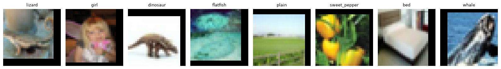
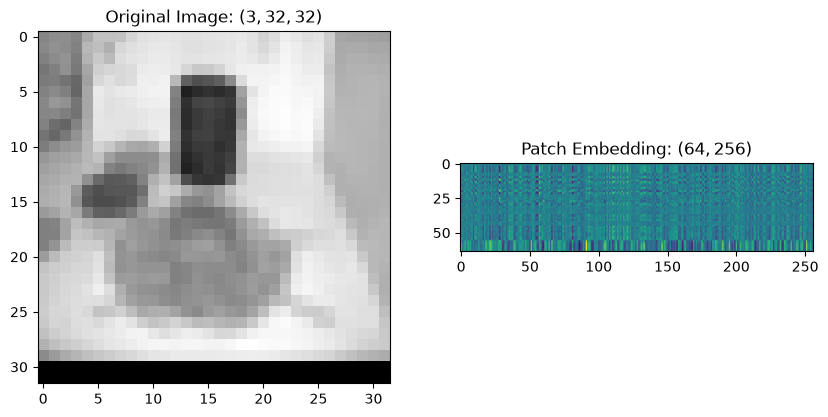
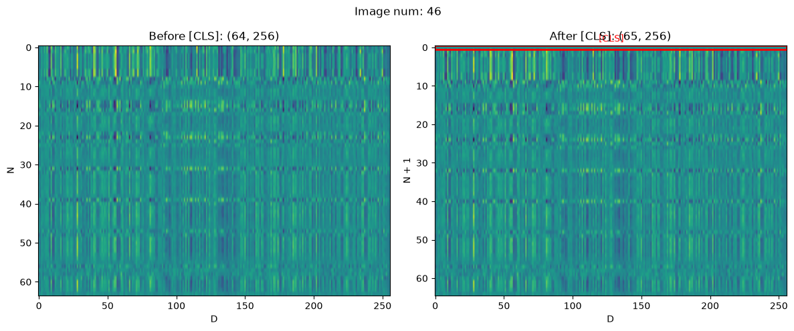
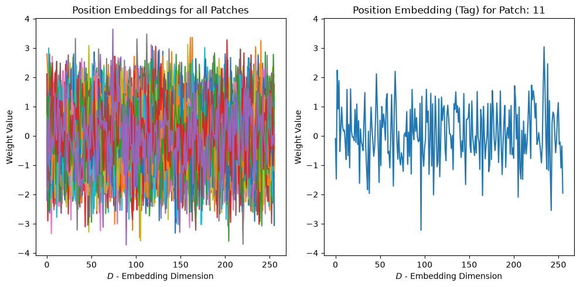
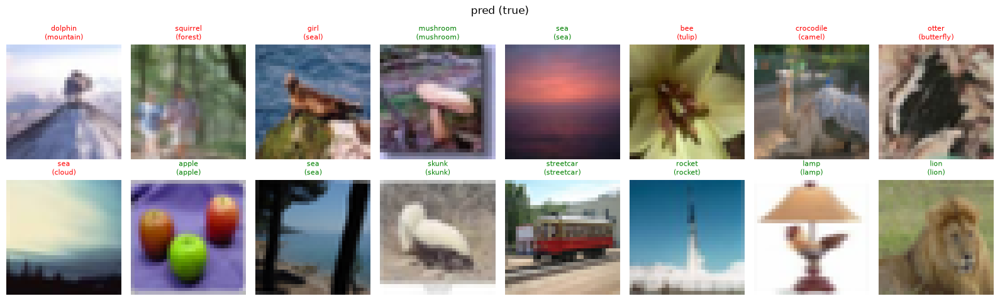
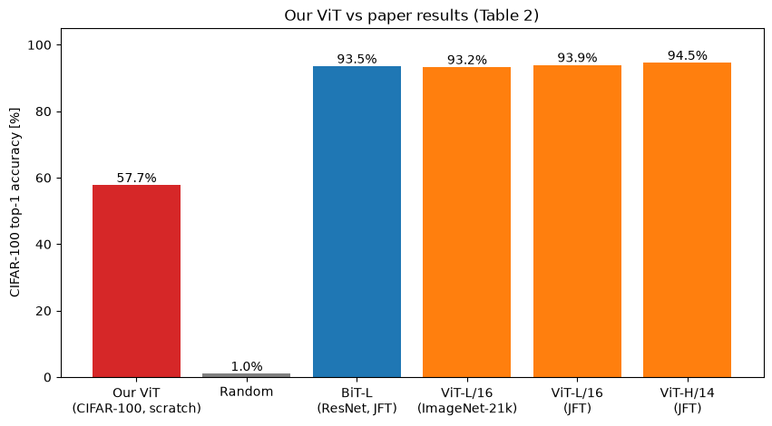
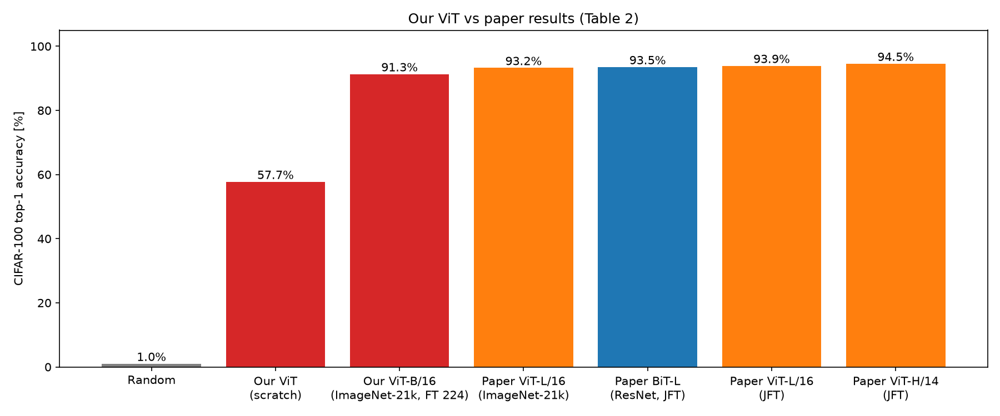

# Vision Transformer from scratch

A PyTorch reimplementation of **"An Image is Worth 16x16 Words: Transformers for Image Recognition at Scale"** ([Dosovitskiy et al., ICLR 2021](https://arxiv.org/abs/2010.11929)), including:

* a ViT written from scratch (patch embedding, [CLS] token, position embeddings, pre-LN encoder, Eq. 1-4 of the paper) with the official initialization
* training from scratch on CIFAR-100
* loading the **official Google ViT-B/16 weights (ImageNet-21k)** 1:1 into this implementation (verified against `timm` in `tests/`) and fine-tuning them on CIFAR-100 following the paper's recipe
* a step-by-step explanation notebook, a Gradio demo and Hugging Face Hub export

## 📓 Walkthrough notebook

**[`notebooks/ViT_An_Image_is_Worth_16x16_Words_Transformers_for_Image_Recognition_at_Scale.ipynb`](notebooks/ViT_An_Image_is_Worth_16x16_Words_Transformers_for_Image_Recognition_at_Scale.ipynb)** derives every component of the model from the paper, first manually and then with PyTorch modules, checking that both give the same result:

**1. Data.** CIFAR-100, pixels scaled to $[-1, 1]$ as in the official code.



**2. Patch embedding.** The image $x \in \mathbb{R}^{H \times W \times C}$ is cut into $N = HW/P^2$ patches and linearly projected to $D$ dimensions (`unfold` + `Linear` vs a single `Conv2d` with `kernel_size = stride = P`).



**3. [CLS] token.** A learnable token is prepended to the sequence; its output $z_L^0$ is the image representation.



**4. Position embeddings.** A learnable vector per position, added to every image in the batch (Eq. 1):

$$z_0 = [x_{class};\ x_p^1E;\ x_p^2E;\ \dots;\ x_p^NE] + E_{pos}$$



**5. Transformer encoder.** Pre-LN blocks $z'_\ell = \text{MSA}(\text{LN}(z_{\ell-1})) + z_{\ell-1}$, $z_\ell = \text{MLP}(\text{LN}(z'_\ell)) + z'_\ell$ and the classification head on $y = \text{LN}(z_L^0)$ (Eq. 2-4).

**6. Training from scratch and evaluation.**





## Results (CIFAR-100, test top-1)

| Model | Pre-training | Fine-tuning | Top-1 |
|---|---|---|---|
| Our ViT (D=256, 12 blocks, patch 4) | none (from scratch, 200 epochs) | - | 57.7% |
| Our ViT-B/16 | ImageNet-21k (official weights) | 224 px, 500 steps, lr 0.03 | **91.3%** (top-5 99.0%) |
| Paper ViT-L/16 | ImageNet-21k | 384 px, 10k steps | 93.25% |
| Paper ViT-H/14 | JFT-300M | 384 px, 10k steps | 94.55% |

Training from scratch reproduces the paper's main observation: without large-scale pre-training ViT lacks the inductive biases of CNNs and overfits small datasets (train 99.97% vs test 57.7%). Transfer from ImageNet-21k closes most of the gap.



Fine-tuned weights: [huggingface.co/AdrianSK/vit-b16-in21k-cifar100](https://huggingface.co/AdrianSK/vit-b16-in21k-cifar100)

## Structure

```
src/vit/
  model.py       ViT and the encoder Block
  data.py        CIFAR-100 loading and preprocessing (pixels in [-1, 1], as in the official code)
  engine.py      device, warmup + cosine schedule, evaluation, checkpoints
  pretrained.py  official weights -> our ViT, 2D interpolation of position embeddings
  train.py       training from scratch
  finetune.py    fine-tuning with minival LR sweep
  predict.py     single-image inference
  results.py     comparison plot vs the paper
  hub.py         export to the Hugging Face Hub (safetensors)
app/app.py       Gradio demo
notebooks/       step-by-step derivation of every component
tests/           shapes, patching equivalence, official weights vs timm
```

## Setup

```bash
python -m venv .venv && source .venv/bin/activate
pip install -e ".[app,dev]"
pytest                      # RUN_SLOW=1 pytest also checks the official weights (~350 MB download)
```

## Usage

```bash
# Train from scratch (~200 epochs, works on CUDA / MPS / CPU)
python -m vit.train --out checkpoints/vit_cifar100

# Fine-tune official ViT-B/16 as in the paper (384 px, 10k steps, batch 512, lr sweep) - needs a CUDA GPU
python -m vit.finetune

# Reduced fine-tuning that fits a laptop GPU (MPS)
python -m vit.finetune --img-size 224 --steps 500 --warmup-steps 25 --lrs 0.03 --micro-batch 32

# Predict, plot results, run the demo
python -m vit.predict image.jpg --ckpt checkpoints/vit_b16_in21k_cifar100/vit.pt
python -m vit.results
python app/app.py --ckpt checkpoints/vit_b16_in21k_cifar100/vit.pt

# Publish to the Hugging Face Hub
python -m vit.hub checkpoints/vit_b16_in21k_cifar100 --repo <user>/vit-b16-in21k-cifar100
```

## Fine-tuning recipe (paper, Appendix B.1.1)

* replace the pre-training head with a zero-initialized linear layer
* fine-tune at a higher resolution than pre-training, keeping the patch size, and 2D-interpolate the position embeddings
* SGD with momentum 0.9, batch 512, no weight decay, linear warmup + cosine decay, gradient clipping at global norm 1
* pick the learning rate from {0.001, 0.003, 0.01, 0.03} on a 2% minival split held out from the training set

## Reference

```bibtex
@inproceedings{dosovitskiy2021image,
  title     = {An Image is Worth 16x16 Words: Transformers for Image Recognition at Scale},
  author    = {Dosovitskiy, Alexey and Beyer, Lucas and Kolesnikov, Alexander and Weissenborn, Dirk and Zhai, Xiaohua and Unterthiner, Thomas and Dehghani, Mostafa and Minderer, Matthias and Heigold, Georg and Gelly, Sylvain and Uszkoreit, Jakob and Houlsby, Neil},
  booktitle = {ICLR},
  year      = {2021}
}
```
